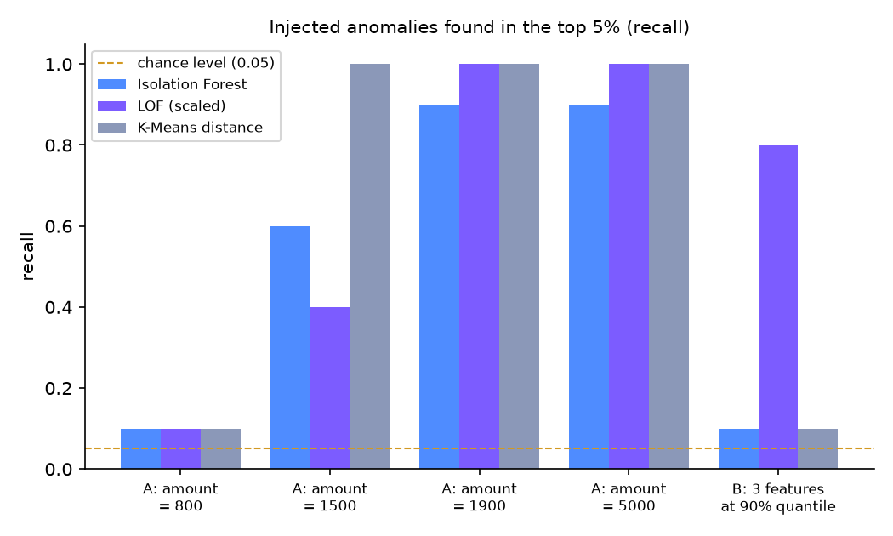
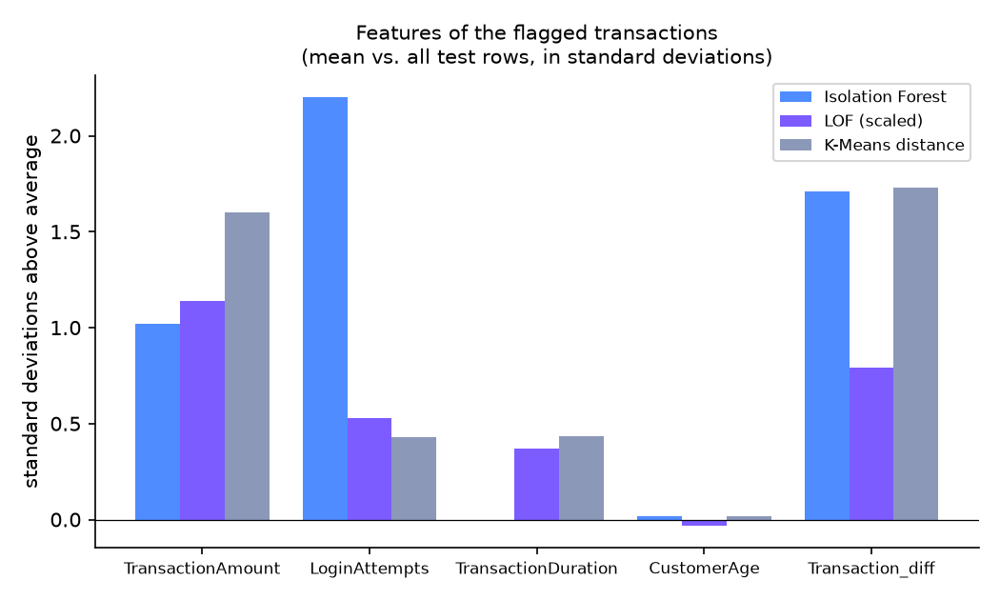
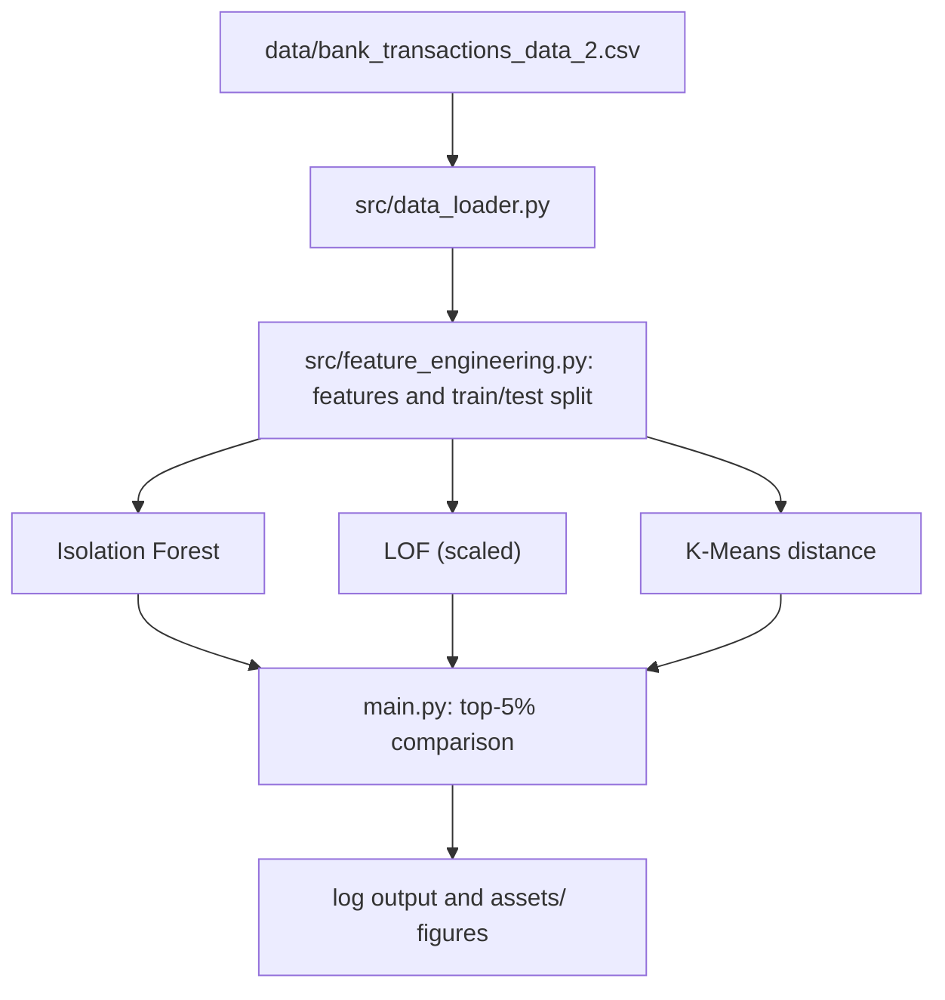

<p align="center">
  
</p>

<p align="center">
  
  
  
  
</p>

Unsupervised anomaly detection on a bank transaction dataset that comes without fraud labels. Isolation Forest, Local Outlier Factor and a K-Means distance score are compared on a leakage-free feature pipeline and evaluated without labels, using injected anomalies. The result is a reproducible pipeline (`main.py`), a documented exploration notebook and an honest picture of what each method can and cannot find.

| | |
|---|---|
| **Context** | Private project |
| **Period** | Aug 2026 - Oct 2026 |
| **Team** | Solo |
| **Tech** | Python, pandas, scikit-learn, matplotlib, pytest |

📖 **[Full exploration and design decisions → notebooks/01_eda.ipynb](notebooks/01_eda.ipynb)**

## Results at a glance

<p align="center">
  
  
</p>

The three methods flag different transactions: the top 5% of Isolation Forest and LOF share only 13 of 37 transactions, Isolation Forest and K-Means share 22 of 37. In a test with injected anomalies (chance level 0.05) K-Means found single extreme amounts best, and LOF was the only method that found rows that are only moderately high in several features at once (recall 0.8 vs. 0.1). There are no labels, so none of this shows which method finds real fraud.

| Metric | Result |
|---|---|
| Top-5% overlap, Isolation Forest vs. LOF | 13 of 37 |
| Top-5% overlap, Isolation Forest vs. K-Means | 22 of 37 |
| Top-5% overlap, LOF vs. K-Means | 14 of 37 |
| Isolation Forest, top-5% overlap between two random seeds | 0.85 |
| Recall, three features moderately high (Isolation Forest / LOF / K-Means) | 0.1 / 0.8 / 0.1 |

## Architecture



## Project structure

```text
fraud-detection/
├── main.py                  # runs the three models and compares their top-5% groups
├── make_figures.py          # recreates the figures in assets/
├── src/
│   ├── config.py            # random state, test size
│   ├── data_loader.py       # loads the CSV and checks the required columns
│   ├── feature_engineering.py  # features, missing values, train/test split
│   └── models.py            # Isolation Forest, LOF and K-Means scoring
├── notebooks/01_eda.ipynb   # exploration, discarded ideas, model experiments
├── tests/                   # pytest tests for loader, features and models
├── data/                    # input CSV
├── assets/                  # banner and README figures
├── pytest.ini
├── requirements.txt
└── README.md
```

## Outputs

- `assets/injected-anomalies-recall.png` — recall of injected anomalies per method, produced by `make_figures.py`
- `assets/feature-profile.png` — features in which the flagged transactions stand out, produced by `make_figures.py`
- console log of `main.py` — size and average values of each method's top-5% group and the overlap between methods
- `notebooks/01_eda.ipynb` — exploration with outputs, including the ideas that were tested and discarded

## Running it

```bash
git clone https://github.com/mhauser2708-tech/fraud-detection.git
cd fraud-detection
python -m venv venv
venv\Scripts\activate    # macOS/Linux: source venv/bin/activate
pip install -r requirements.txt
python main.py           # run the three models and print the comparison
python make_figures.py   # recreate the figures in assets/
pytest                   # run the tests
```

Requires `pandas`, `numpy`, `scikit-learn`, `matplotlib` and `pytest` (Python 3.12+). To open the notebook, select the `venv` kernel.

Paths are resolved relative to the code, so it runs from a clone in any location. The data is not my work: it is the Kaggle dataset [*Bank Transaction Dataset for Fraud Detection*](https://www.kaggle.com/datasets/valakhorasani/bank-transaction-dataset-for-fraud-detection) by valakhorasani (2,512 transactions, 16 columns, no fraud label), published under the [Apache License 2.0](https://www.apache.org/licenses/LICENSE-2.0). It is included in `data/` only so that the project can be reproduced; all credit for the data belongs to its author.

## Methodology

Feature ideas were tested on the data before use: those that need consistent per-account history (location, IP, device, balance direction) did not hold up and were discarded. Preprocessing is leakage-free, because the median that fills the first transaction of each account is learned on the training split only and applied to the test split, and 14 pytest tests cover loader, features and models. Without labels, the methods are compared by the overlap of their top-5% groups, stability across random seeds and recall on injected anomalies, always against chance level (0.05) and seed noise. The numbers describe how the methods differ and say nothing about real fraud detection quality.

## What I learned

- Checking an assumption with a small experiment beats trusting it: Isolation Forest does not need scaling (score correlation 1.0), while LOF does (only 10 of 37 flagged rows in common with and without scaling).
- Anything learned from the data, such as a fill value, belongs to the training split only (fit on train, transform on test).
- A dataset description is a claim, not a fact: it describes the balance as logically linked to transaction type and `PreviousTransactionDate` as the account's last transaction, but about 50% of balance changes pointed in the wrong direction and all previous dates fall on one export day.
